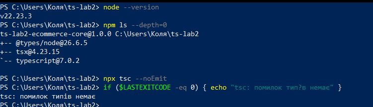
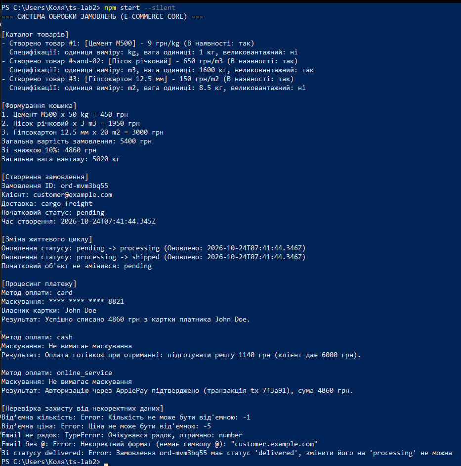
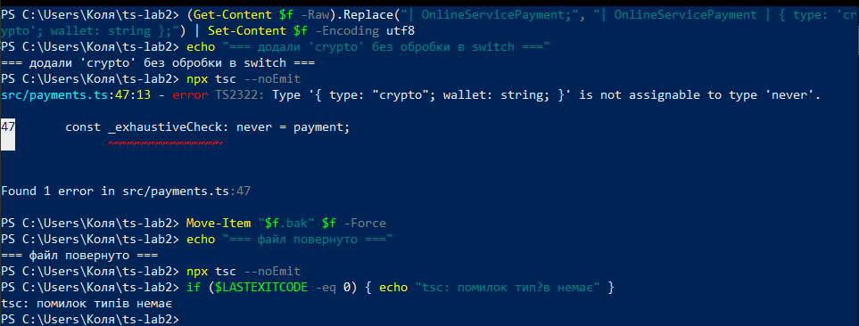

# Практична робота № 2

**Тема:** Базові засоби системи типів TypeScript

**Виконав:** Дурицький М.М., група КН-43

**Варіант:** 6 (будівельні матеріали)

## Опис

Модуль типізованого ядра інтернет-магазину (E-Commerce Core Engine) на TypeScript у суворому режимі, без використання типу `any`. Моделюються каталог товарів, кошик, замовлення з життєвим циклом та різні способи оплати.

Специфіка варіанта 6:

| Параметр | Значення |
|----------|----------|
| Категорія | Будівельні матеріали |
| Характеристики товару | `unitOfMeasure: 'kg' \| 'm2' \| 'm3'`, `weightPerUnitKg: number`, `isHeavyCargo: boolean` |
| Способи доставки | `'cargo_freight' \| 'courier' \| 'warehouse_pickup'` |

## Середовище

- Windows, PowerShell
- Node.js v22.23.3, npm
- TypeScript 7.0.2, tsx 4.23.15, @types/node 26.6.5
- Visual Studio Code, Git

## Структура проєкту

```
ts-lab2/
├── package.json        - залежності та команди start / typecheck
├── tsconfig.json       - суворий режим компіляції
├── README.md
├── screenshots/
└── src/
    ├── types.ts        - EntityId, BaseProduct, Product, OrderStatus, DeliveryMethod, CartItem, Order
    ├── catalog.ts      - createProduct, calculateLineTotal
    ├── validation.ts   - validateCustomerInput (звуження unknown)
    ├── orders.ts       - createOrder, updateOrderStatus, calculateCartTotal
    ├── payments.ts     - PaymentDetails, isCreditCardPayment, maskCardNumber, processPayment
    └── index.ts        - демонстрація роботи системи
```

## Запуск

```powershell
npm install
npm run typecheck   # перевірка типів (tsc --noEmit)
npm start           # tsx src/index.ts
```

Налаштування `tsconfig.json`: `target: ES2022`, `module: NodeNext`, `moduleResolution: NodeNext`, `strict`, `noImplicitAny`, `strictNullChecks`, `noUncheckedIndexedAccess`. У `package.json` додано `"type": "module"`, тому імпорти між файлами пишуться з розширенням `.js` (вимога `NodeNext`).

---

## Рівень 1. Структура проєкту та моделювання сутностей

**Ініціалізація:** `npm init`, dev-залежності `typescript`, `tsx`, `@types/node`, скрипт `"start": "tsx src/index.ts"`, `tsconfig.json` із суворими прапорцями.

**Базові типи** (`src/types.ts`):

```ts
export type EntityId = string | number;

export interface BaseProduct {
  readonly id: EntityId;
  title: string;
  price: number;
  description?: string;
  tags: string[];
  inStock: boolean;
}

export type UnitOfMeasure = 'kg' | 'm2' | 'm3';

export interface Product extends BaseProduct {
  unitOfMeasure: UnitOfMeasure;
  weightPerUnitKg: number;
  isHeavyCargo: boolean;
}
```

**Функції каталогу** (`src/catalog.ts`):

- `createProduct(id, data): Product` приймає `ProductData = Omit<Product, 'id'>`, перевіряє назву, ціну та вагу (від'ємні значення дають `Error`), копіює масив `tags`, щоб зовнішній масив не міг змінити товар.
- `calculateLineTotal(price, quantity, discountPercent = 0): number` використовує параметр за замовчуванням, кидає `Error` при від'ємній ціні, кількості та при знижці поза діапазоном 0-100.

---

## Рівень 2. Гнучка типізація та безпечне опрацювання

**Життєвий цикл замовлення:**

```ts
export type OrderStatus = 'pending' | 'processing' | 'shipped' | 'delivered' | 'cancelled';
export type DeliveryMethod = 'cargo_freight' | 'courier' | 'warehouse_pickup';

export type TimestampMetadata = {
  readonly createdAt: Date;
  updatedAt: Date;
};

export type Order = {
  readonly orderId: string;
  customerEmail: string;
  items: CartItem[];
  status: OrderStatus;
  delivery: DeliveryMethod;
} & TimestampMetadata;
```

`Order` складається з власних полів і `TimestampMetadata` через перетин типів (`&`).

**Зміна стану** (`src/orders.ts`): `updateOrderStatus(order, newStatus)` є чистою функцією: повертає новий об'єкт із новим `status` і актуальним `updatedAt`, а старий об'єкт не змінюється. Якщо поточний статус `cancelled` або `delivered`, кидається `Error`.

**Безпечна обробка невідомих даних** (`src/validation.ts`): `validateCustomerInput(input: unknown): string`.

1. `typeof input !== 'string'` → `TypeError`;
2. порожній рядок після `trim()` → `Error`;
3. немає символу `@` → `Error`;
4. повертається очищений рядок.

---

## Рівень 3. Discriminated Unions, Type Guards та Exhaustive Check

**Способи оплати** (`src/payments.ts`) зі спільним дискримінатором `type`:

```ts
export type CreditCardPayment = { type: 'card'; cardNumber: string; cardHolder: string; cvv: string };
export type CashOnDeliveryPayment = { type: 'cash'; cashAmountToPay: number };
export type OnlineServicePayment = {
  type: 'online_service';
  serviceName: 'ApplePay' | 'GooglePay';
  transactionRef: string;
};
export type PaymentDetails = CreditCardPayment | CashOnDeliveryPayment | OnlineServicePayment;
```

**Custom Type Guard та маскування:**

```ts
export function isCreditCardPayment(payment: PaymentDetails): payment is CreditCardPayment {
  return payment.type === 'card';
}
```

`maskCardNumber` викликає цей захисник: для картки повертає `**** **** **** 8821`, для інших способів `Не вимагає маскування`. Усередині гілки `if` компілятор знає, що це `CreditCardPayment`, тому поле `cardNumber` доступне без приведення типів.

**Процесинг із вичерпною перевіркою:** `processPayment(payment, amount)` розгалужується через `switch (payment.type)`. Для `cash` перевіряється, чи клієнт дає більше за суму (тоді готується решта). У гілці `default`:

```ts
default: {
  const _exhaustiveCheck: never = payment;
  throw new Error(`Невідомий спосіб оплати: ${JSON.stringify(_exhaustiveCheck)}`);
}
```

Якщо додати новий варіант у `PaymentDetails` і не обробити його в `switch`, змінна `payment` у `default` матиме тип, відмінний від `never`, і компіляція завершиться помилкою (див. демонстрацію нижче).

---

## Результати

### Версії та перевірка типів

`tsc --noEmit` завершується без помилок, встановлені три dev-залежності.



### Запуск програми (`npm start`)

Демонстрація: створення трьох товарів (цемент, пісок, гіпсокартон), кошик із підсумком і знижкою 10%, замовлення зі зміною статусу `pending → processing → shipped`, оплата трьома способами, перевірка некоректних даних. Для товару з `isHeavyCargo: true` (пісок) обрано доставку `cargo_freight`, також виводиться загальна вага вантажу.



Помилки з нижнього блоку виводу очікувані: це перевірка захисту (від'ємна кількість і ціна, не рядок, немає `@`, зміна статусу з `delivered`). Програма їх перехоплює й завершується без збоїв.

### Демонстрація exhaustiveness check

Тимчасово додано четвертий спосіб оплати `crypto` без обробки в `switch`. Компілятор видає помилку `TS2322: Type '{ type: "crypto"; wallet: string; }' is not assignable to type 'never'` у рядку з `_exhaustiveCheck`. Після повернення файлу `tsc` знову проходить без помилок.



---

## Відповіді на контрольні питання

**1. Чим TypeScript відрізняється від JavaScript? Що відбувається з типами під час компіляції?**
TypeScript це надмножина JavaScript зі статичною типізацією. Типи перевіряються на етапі компіляції, а в готовому JavaScript їх немає: компілятор стирає анотації, інтерфейси та type alias. Тому під час виконання перевірки типів не відбувається, і дані ззовні (JSON, форми) все одно треба валідувати.

**2. Переваги `"strict": true`. Що перевіряють `noImplicitAny` та `strictNullChecks`?**
`strict` вмикає групу суворих перевірок разом (серед них `noImplicitAny`, `strictNullChecks`, `strictFunctionTypes`, `strictPropertyInitialization`). `noImplicitAny` забороняє змінні й параметри з неявним типом `any`, якщо компілятор не може вивести тип. `strictNullChecks` робить `null` та `undefined` окремими типами, тож звернення до значення, яке може бути `null`, без перевірки не компілюється.

**3. Різниця між `any` та `unknown`.**
`any` вимикає перевірку типів: з таким значенням можна робити будь-що, і помилки з'являться лише під час виконання. `unknown` приймає будь-яке значення, але перед використанням змушує звузити тип (`typeof`, `in`, type guard). У проєкті `validateCustomerInput(input: unknown)` спочатку перевіряє `typeof input === 'string'`, тому безпечніше.

**4. Чим кортеж (tuple) відрізняється від масиву `Array<T>`?**
Масив має довільну довжину й один тип елементів. Кортеж має фіксовану кількість елементів, і для кожної позиції свій тип, наприклад `[latitude: number, longitude: number]`. Спроба звернутися до неіснуючої позиції кортежу дає помилку компіляції.

**5. Union та intersection.**
Union (`|`): значення належить одному з типів. Приклад: `EntityId = string | number`, `OrderStatus = 'pending' | 'processing' | ...`. Intersection (`&`): значення має властивості всіх типів одночасно. Приклад: `Order = { orderId, items, ... } & TimestampMetadata`.

**6. Discriminated union та поле-дискримінатор.**
Це об'єднання типів, у яких є спільне поле з унікальним літеральним значенням у кожного варіанта. У проєкті це `PaymentDetails` з полем `type` (`'card'`, `'cash'`, `'online_service'`). За значенням цього поля компілятор точно визначає варіант, тому в `case 'card'` доступні `cardNumber` і `cardHolder`, а в `case 'cash'` лише `cashAmountToPay`.

**7. Type guard та синтаксис `value is TargetType`.**
Type guard це функція, яка під час виконання перевіряє значення й повідомляє компілятору, що тип у відповідній гілці вужчий. Оголошується із предикатом у типі повернення: `function isCreditCardPayment(payment: PaymentDetails): payment is CreditCardPayment { return payment.type === 'card'; }`. Усередині `if (isCreditCardPayment(payment))` змінна `payment` має тип `CreditCardPayment`.

**8. Призначення `never` у `default` та exhaustiveness checking.**
Після обробки всіх варіантів у `switch` змінна в `default` має тип `never`, тобто такого значення бути не може. Присвоєння `const _exhaustiveCheck: never = payment` компілюється лише тоді, коли оброблено всі варіанти. Якщо додати новий спосіб оплати й забути його в `switch`, у `default` потрапляє тип, відмінний від `never`, і компіляція падає. Так помилка знаходиться під час збірки, а не в роботі програми.

---

## Висновки

Налаштовано TypeScript-проєкт із суворим режимом компіляції та запуском через `tsx`. Змодельовано каталог, кошик і замовлення за допомогою інтерфейсів, union- та intersection-типів. Реалізовано безпечну обробку невідомих даних через `unknown` і звуження типів, розпізнавані об'єднання для способів оплати, користувацький type guard і вичерпну перевірку через `never`, яку підтверджено демонстрацією помилки компіляції. У коді немає жодного використання `any`.
